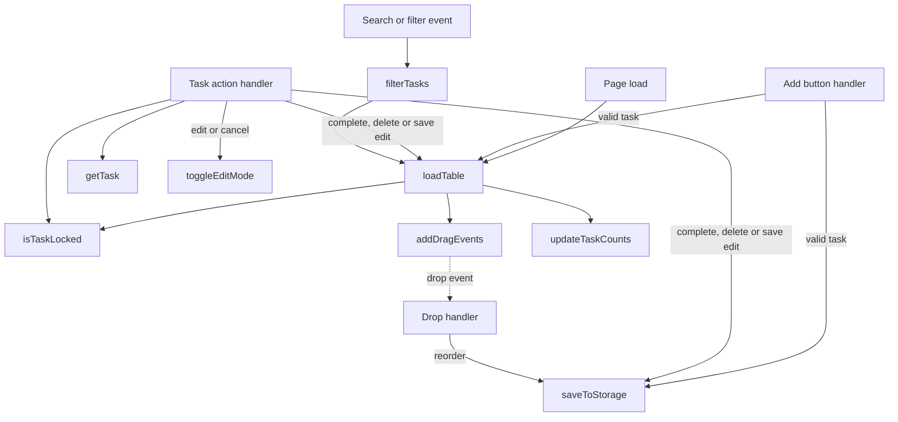
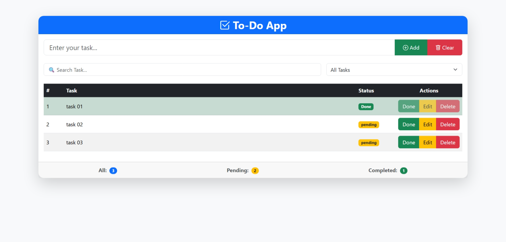

# To-Do App

Manage tasks in a browser while practicing DOM manipulation and local storage.

## Current features

- Add, edit, delete, and complete tasks; search and filter the task list.
- Reorder displayed tasks using drag-and-drop and see task counters.
- Save tasks and their IDs in browser local storage.

Completed tasks are locked against editing and deletion. The Clear button
clears the input rather than the task list.

## JavaScript concepts

Events and event delegation, DOM creation, arrays and objects, validation,
local storage, and HTML drag-and-drop.

## Function flow

The diagram shows the main calls and event-driven paths in
[`js/app.js`](./js/app.js). Dashed arrows represent later user events.

`loadTable` rebuilds the visible rows, attaches drag handlers, and refreshes
the counters. The drop handler saves the order without calling `loadTable`.

## Run

Follow the [repository setup](../README.md#running-the-projects) and open
`01-To-Do-App/index.html`. Bootstrap and Bootstrap Icons require an internet
connection. Browser storage is local to the current origin and browser.

## Screenshot

Add `image.png` to this project folder to display the screenshot below.

