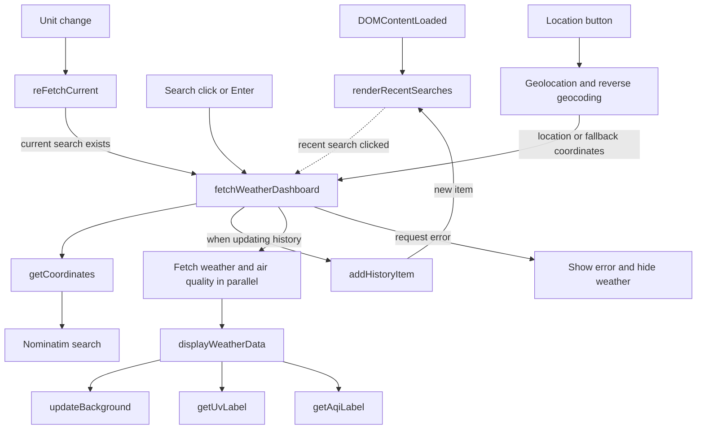
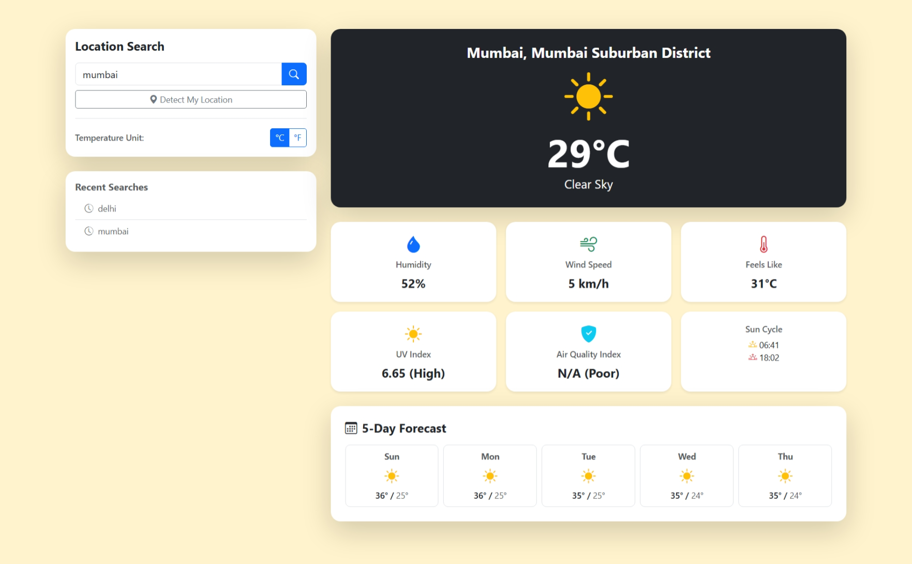

# Weather Dashboard

Look up weather and practice combining asynchronous browser API requests.

## Current features

- Search locations, view recent searches, or request the browser's location.
- Display current conditions, a five-day forecast, UV index, air quality,
  sunrise, and sunset.
- Switch between Celsius and Fahrenheit; keep recent searches in local
  storage.

## JavaScript concepts

Fetch, async/await, JSON, error handling, DOM updates, local storage, and
geolocation.

## Function flow

The diagram follows the main paths in [`js/app.js`](./js/app.js).
Dashed arrows represent later user events, not direct function calls.

`displayWeatherData` also renders the current conditions and forecast.

## Run and dependencies

Follow the [repository setup](../README.md#running-the-projects) and open
`02-Weather-Dashboard/index.html`. The dashboard uses Bootstrap, Bootstrap
Icons, OpenStreetMap Nominatim for geocoding, and Open-Meteo for weather and
air quality. These services require network access. Location detection also
requires browser permission and a secure context.

## Screenshot

Add `image.png` to this project folder to display the screenshot below.

