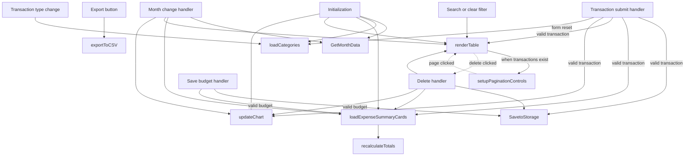
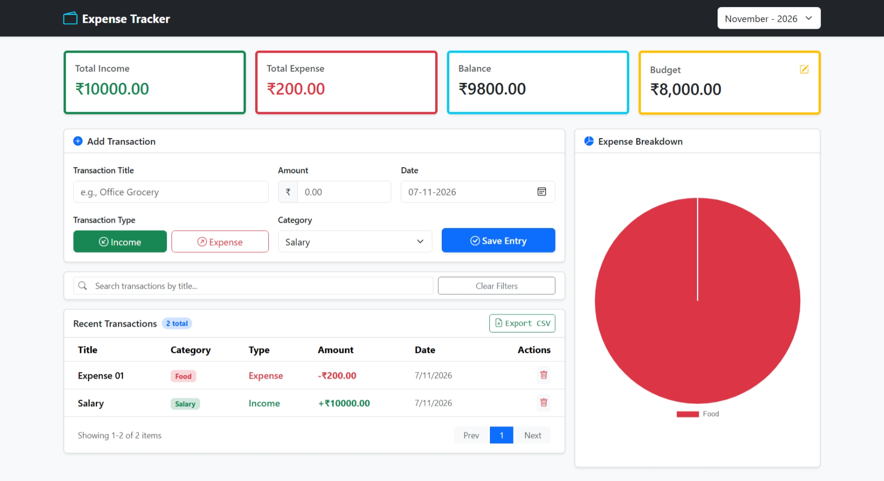

# Expense Tracker

Track income and expenses by month and explore summaries and visualizations.

## Current features

- Add and delete categorized transactions and search transaction titles.
- Select a financial-year month, set a budget, and view income, expenses,
  balance, and an expense-category chart.
- Paginate transactions, export the selected month's data to CSV, and save
  data in browser local storage.

The current interface does not edit existing transactions.

## JavaScript concepts

Form handling, arrays and objects, filtering, local storage, pagination,
chart data, and CSV generation.

## Function flow

The diagram summarizes the main calls in [`js/app.js`](./js/app.js).
Dashed arrows represent callbacks triggered by later user actions.

The summary recalculates totals, while the chart groups expenses by category.
The export function builds a CSV from the selected month's transactions.

## Run and dependencies

Follow the [repository setup](../README.md#running-the-projects) and open
`03-Expense-Tracker/index.html`. Bootstrap, Bootstrap Icons, and Chart.js are
loaded from CDNs and require network access. Data stays in the current
browser's local storage.

## Screenshot

Add `image.png` to this project folder to display the screenshot below.

