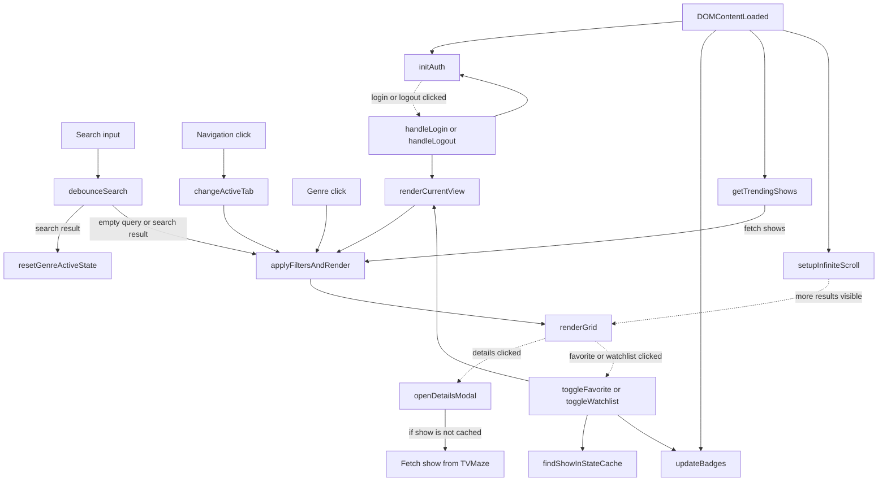
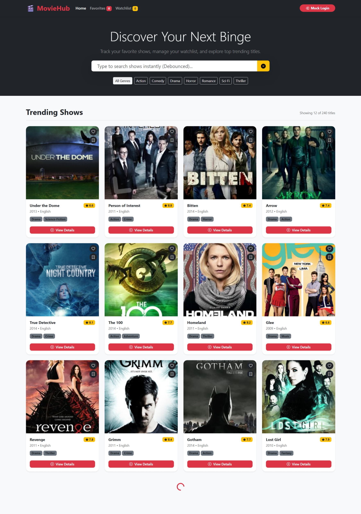

# Movie Search App

Browse and search TV shows using TVMaze, and keep local favorites and a
watchlist.

## Current features

- Browse an initial show collection, search with a debounce, and filter by
  genre.
- View show details, ratings, and a trailer-search embed; load more results
  as the page is scrolled.
- Save favorites and watchlist entries in local storage.
- Use a mock guest login. It is not real authentication.

Results and the trailer embed depend on external services; the initial
"Trending Shows" view uses the API's general shows endpoint rather than a
verified trending ranking.

## JavaScript concepts

Fetch, async/await, debouncing, dynamic rendering, state, local storage,
filtering, and the Intersection Observer API.

## Function flow

The diagram shows the main paths in [`js/app.js`](./js/app.js). Dashed
arrows represent callbacks triggered by later interactions.

Search waits 400 ms before requesting results. Favorites, watchlist entries,
and the mock login are stored locally.

## Run and dependencies

Follow the [repository setup](../README.md#running-the-projects) and open
`04-Movie-Search-App/index.html`. Bootstrap, Bootstrap Icons, TVMaze, and
external images and trailer content require network access.

## Screenshot

Add `image.png` to this project folder to display the screenshot below.

