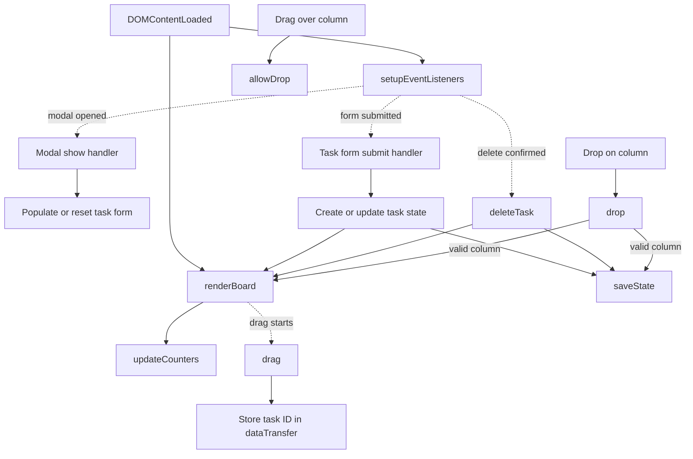
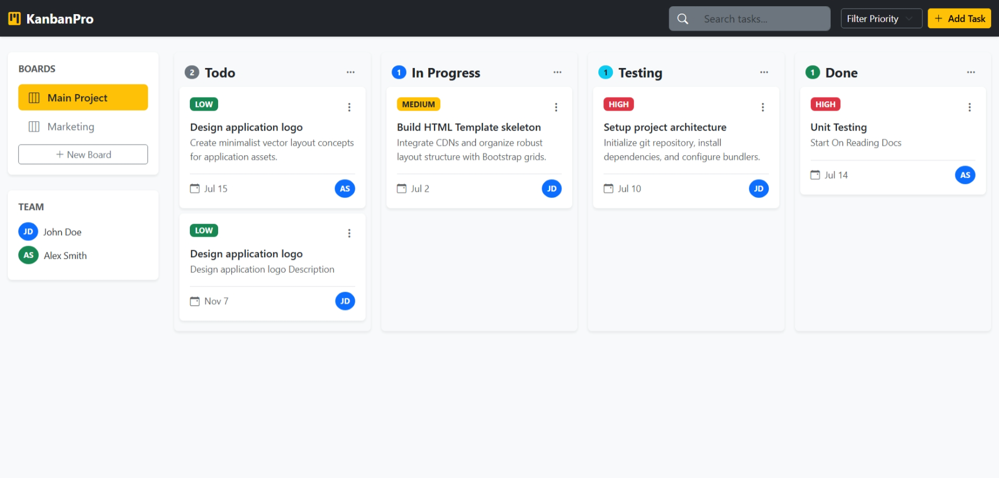

# Kanban Task Board

Organize task cards across Todo, In Progress, Testing, and Done columns.

## Current features

- Create, edit, and delete cards with a title, description, priority, due date,
  and assignee.
- Drag cards between columns, view column counts, and persist the board in
  local storage.
- Start with sample tasks when no saved board is present.

The sidebar boards and team list, search, and priority filter are currently
presentational; they do not manage separate boards or filter tasks.

## JavaScript concepts

DOM rendering, event delegation, forms, Bootstrap modals, local storage,
application state, and HTML drag-and-drop.

## Function flow

The diagram follows the main paths in [`js/app.js`](./js/app.js).
Dashed arrows represent later user or browser events.

`renderBoard` rebuilds cards from the saved state and updates the counts.
The modal and drop handlers update state before saving and rendering again.

## Run

Follow the [repository setup](../README.md#running-the-projects) and open
`05-Kanban-Task-Board/index.html`. Bootstrap and Bootstrap Icons require an
internet connection. Board data stays in the current browser's local storage.

## Screenshot

Add `image.png` to this project folder to display the screenshot below.

