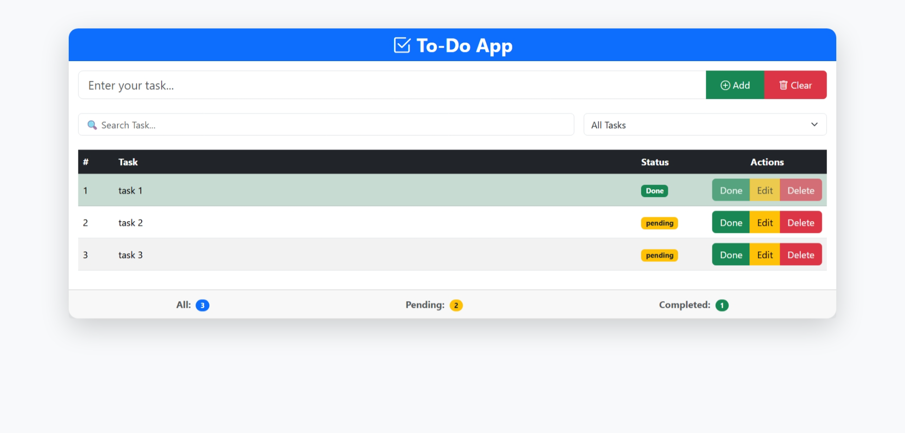
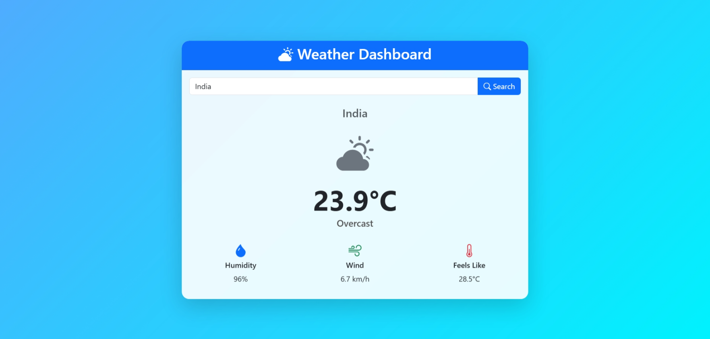

# 🚀 Vanilla JavaScript Project Roadmap

## 📖 About

This repository is my personal journey to mastering **Vanilla JavaScript**. The goal is to strengthen my JavaScript skills by building real-world projects, starting with beginner-friendly applications and progressing to more advanced ones.
Each project focuses on important JavaScript concepts like DOM manipulation, asynchronous programming, APIs, local storage, and application architecture.

---

# 📚 Projects

## 1. ✅ To-Do App

### Difficulty

⭐ Beginner → ⭐⭐ Intermediate

### Description

A task management application where users can create, edit, delete, search, and organize their daily tasks.

### Features

- Add task
- Edit task
- Delete task
- Mark as completed
- Search tasks
- Filter tasks
  - All
  - Active
  - Completed
- Store tasks in Local Storage

### Bonus Features

- Drag & Drop
- Due Dates
- Categories
- Dark Mode

### Concepts Practiced

- DOM Manipulation
- Event Listeners
- Arrays
- Objects
- Local Storage
- Event Delegation
- CRUD Operations

## 

## 2. 🌦 Weather Dashboard

### Difficulty

⭐⭐⭐ Intermediate

### Description

A weather application that displays current weather conditions and forecasts using a public weather API.

### Features

- Search by city
- Current weather
- 5-Day Forecast
- Weather icons
- Celsius/Fahrenheit switch
- Recent searches
- Detect current location

### Bonus Features

- Air Quality Index
- UV Index
- Sunrise & Sunset
- Dynamic backgrounds

### Concepts Practiced

- Fetch API
- Async/Await
- JSON
- Error Handling
- Loading States
- Browser Geolocation API

## 

---

## 3. 💰 Expense Tracker

### Difficulty

⭐⭐⭐⭐ Intermediate+

### Description

A finance tracker to manage income and expenses while displaying reports and balance summaries.

### Features

- Add income
- Add expenses
- Edit records
- Delete records
- Categories
- Monthly summary
- Search transactions
- Save data locally

### Bonus Features

- CSV Export
- Pie Charts
- Budget Alerts
- Monthly Reports

### Concepts Practiced

- Objects
- Arrays
- Local Storage
- Modular JavaScript
- Data Filtering
- Basic Data Visualization

---

## 4. 🎬 Movie Search App

### Difficulty

⭐⭐⭐⭐ Intermediate → Advanced

### Description

A movie browser that searches movie information from an external API.

### Features

- Search movies
- Movie details
- Ratings
- Release year
- Favorites
- Watchlist
- Infinite scrolling
- Pagination

### Bonus Features

- Trailer popup
- Genre filters
- Trending movies
- User authentication

### Concepts Practiced

- API Integration
- Debouncing
- Dynamic Rendering
- Async/Await
- State Management
- Search Optimization

---

## 5. 📋 Kanban Task Board

### Difficulty

⭐⭐⭐⭐⭐ Advanced

### Description

A Trello-style task management application with drag-and-drop functionality.

### Board Structure

```text
Todo
   ↓
In Progress
   ↓
Testing
   ↓
Done
```

### Features

- Create task cards
- Edit cards
- Delete cards
- Drag & Drop cards
- Priority labels
- Due dates
- Auto-save
- Multiple columns

### Bonus Features

- Search
- Filters
- Multiple boards
- Team members
- Activity history

### Concepts Practiced

- Drag & Drop API
- Complex DOM Manipulation
- State Management
- Modular JavaScript
- Local Storage

---

# 📂 Recommended Folder Structure

```text
project-name/
│
├── index.html
├── README.md
│
├── css/
│   ├── style.css
│   └── responsive.css
│
├── js/
│   ├── app.js
│   ├── storage.js
│   ├── ui.js
│   ├── api.js
│   └── utils.js
│
├── assets/
│   ├── images/
│   └── icons/
│
└── data/
```

---

# 🧠 JavaScript Skills Covered

- Variables
- Data Types
- Operators
- Functions
- Scope
- Arrays
- Objects
- Loops
- Conditionals
- ES6 Features
- Template Literals
- Destructuring
- Spread Operator
- Rest Parameters
- Arrow Functions
- Modules
- DOM Manipulation
- Event Handling
- Event Delegation
- Local Storage
- Session Storage
- Fetch API
- Async/Await
- Promises
- JSON
- Error Handling
- CRUD Operations
- Form Validation
- Search & Filter
- Sorting
- Drag & Drop
- Responsive Design
- Browser APIs
- API Integration
- Code Organization

---

# 🛣 Learning Roadmap

```text
JavaScript Basics
        │
        ▼
DOM Manipulation
        │
        ▼
Events
        │
        ▼
Forms & Validation
        │
        ▼
Local Storage
        │
        ▼
Fetch API
        │
        ▼
Promises
        │
        ▼
Async/Await
        │
        ▼
CRUD Applications
        │
        ▼
REST APIs
        │
        ▼
State Management
        │
        ▼
Complex Applications
        │
        ▼
JavaScript Expert 🚀
```

---

# 🎯 Goals

- Build 5 complete JavaScript projects
- Write clean and maintainable code
- Learn modular project structure
- Practice real-world problem solving
- Improve debugging skills
- Understand browser APIs
- Become comfortable building projects without frameworks

---

# 📖 What I'll Learn

By completing these projects, I will gain experience with:

- Building interactive user interfaces
- Working with browser storage
- Consuming REST APIs
- Handling asynchronous code
- Organizing JavaScript into modules
- Writing reusable functions
- Managing application state
- Improving code readability and maintainability

---

# 🛠 Built With

- HTML5
- CSS3
- Vanilla JavaScript (ES6+)

---

# 🚀 Future Projects

After mastering these projects, the next step is to learn:

- React
- TypeScript
- Node.js
- Express.js
- MongoDB
- Next.js

---

# 👨‍💻 Author

**Saideep Arvind Bhange**
Learning JavaScript one project at a time 🚀
